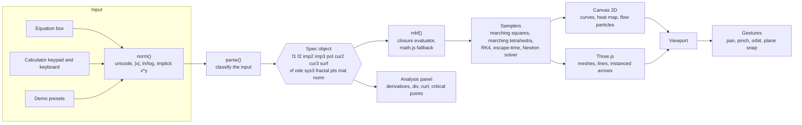

# CalcVisual

An interactive math visualizer and scientific calculator that runs in one HTML file. Type an equation and it is drawn in 2D or 3D as you type, with a live analysis of derivatives, gradients, divergence, curl, and critical points. It is built for students: it works on phones, tablets and PCs, with pinch zoom, a draggable calculator panel, and a symbol row for hard-to-type characters.

Open `index.html` in a browser. There is no build step. It needs an internet connection the first time to load three.js and math.js from a CDN.

## What you can plot

| Input | Example | Views |
|---|---|---|
| `y = f(x)` | `y=ln(x)`, `y=tan(x)` | 2D, 3D |
| `z = f(x,y)` | `z=sin(x)cos(y)` | 2D heat map with contours, 3D surface, vector field |
| Implicit curve | `x^2+y^2=4`, `xy=1` | 2D, 3D |
| Implicit surface | `x^2+y^2+z^2=9` | 2D slice, 3D mesh, vector field |
| Polar | `r=sin(3θ)` | 2D, 3D |
| Parametric curve | `(cos(t),sin(t),t)` | 2D, 3D |
| Parametric surface | `(sin(u)cos(v), sin(u)sin(v), cos(u))` | 3D, vector field |
| Vector field | `<y,-x>`, `<y*z,x*z,x*y>` | 2D animated flow, 3D arrows |
| Slope field | `dy/dx = x+y` | 2D animated flow, 3D |
| Dynamical system | `x'=10(y-x), y'=x(r-z)-y, z'=xy-8z/3` | 3D path, 2D projection |
| Fractals | `mandelbrot`, `julia(-0.8,0.156)` | 2D, 3D height map |
| Points | `(1,2,3)`, `(1,2),(3,4)` | 2D, 3D, vector |
| Matrices | `[[1,2],[3,4]]` up to 4×4 | 2D, 3D (4×4 as a projected tesseract) |
| Normal distribution | `normal(0,1)` | 2D |

Extra letters in an equation, such as `c` in `y=x^2+c`, become sliders. A plane selector slices any 3D equation onto the XY, XZ, or YZ plane.

### Demo presets

The **Flow** button animates vector fields, slope fields and surface gradients in 2D, 3D and the vector-field view. The **Color** menu fills 2D surfaces with a heat map; it is off by default.

Pick a demo from the **Demos** menu or the home page: Mandelbrot set, Lorenz attractor, vector field flow (a damped pendulum), Gaussian surface, Möbius strip, wave interference, 3D saddle surface, and an ODE slope field.

## Architecture



### How an equation becomes a picture

1. **Normalize.** `norm()` rewrites friendly input (`θ`, `π`, `|x|`, `²`, `xy`, `ln(`) into math.js syntax.
2. **Classify.** `parse()` decides what the input is and returns a spec object such as `{kind:'imp3', F, syms}`. Anything that is not a plot variable becomes a slider parameter.
3. **Evaluate.** `mkf()` compiles the expression tree into plain JavaScript closures (no `eval`, so it works under strict security policies). If an expression uses something unsupported, such as `gamma` or `!`, it falls back to math.js.
4. **Sample.** Each kind has a sampler: marching squares for implicit curves, marching tetrahedra for implicit surfaces, RK4 for differential equations and the Lorenz system, escape-time iteration for fractals, and Newton's method for critical points.
5. **Render.** 2D goes to a Canvas 2D layer, with an overlay canvas for animated flow particles. 3D goes to Three.js. Vector arrows are drawn as one instanced mesh, so a thousand arrows cost one draw call.

### Layout of `index.html`

| Region | Responsibility |
|---|---|
| `CORE` block | `norm`, `parse`, `mkf`, `ms`, `isoTris`, `sysTraj`: pure math with no DOM, so it is tested in Node |
| analysis | symbolic derivatives, divergence, curl, roots and critical points |
| 2D renderer | `draw2d`, the `D2` table, flow particles, fractal drawing |
| 3D renderer | `build3d`, the `R3` table, axes with live tick numbers, instanced arrows |
| UI | home page, two-screen panel, drag bar, symbol row, keyboard handling, gestures |

## Performance

- **Closure evaluator.** In the included benchmark, evaluating 200,000 points of `sin(x)cos(y)+x^2/9` took about 3 to 9 ms against about 200 to 400 ms through math.js, and a sphere equation was about 7 to 10 times faster. Exact numbers vary by machine.
- **Touch devices.** The 3D view renders at a capped pixel ratio, skips wireframe overlays, idles at 30 frames per second, and uses coarser sampling grids. Heat maps use larger cells while you drag.
- **Hidden tabs** stop all animation loops.
- On a CPU throttled 4× in headless Chromium, a sphere surface built in about 360 ms. Real tablets have not been measured.

## Deploy

**GitHub Pages (automatic).** Create a new GitHub repository, upload these files, then open **Settings, Pages** and set **Source** to **GitHub Actions**. Every push to `main` runs the tests and publishes `index.html` at `https://YOUR-NAME.github.io/REPO-NAME/`.

**Netlify (no account setup needed to try).** Drag the folder onto <https://app.netlify.com/drop>.

**Anywhere else.** The whole app is `index.html`. Upload that one file to any static host. It loads three.js and math.js from a CDN, so visitors need an internet connection.

## Tests

```
npm install
npm test
```

`tests/parse.test.js` checks that about 90 inputs are classified correctly and that sampled geometry is accurate, for example that sphere vertices lie within 0.05 of the true radius. `tests/engine.test.js` checks the demo presets, that the fast evaluator matches math.js on random points, the Lorenz trajectory bounds, and prints benchmarks.

Manual checks were done in desktop Chromium at phone, tablet, and desktop sizes with simulated touch and keyboard. It has **not** been tested on physical iOS or Android devices.

## Known limits

- No inequality shading (`y > x^2`) and no integral or limit input.
- Implicit surfaces are sampled only inside a cube that scales with zoom.
- Labels are mostly English even though the language menu lists five languages.
- Graphs cannot be saved or shared.

## Stack

three.js r128, math.js 12.4.1, Space Grotesk. Design tokens are in [DESIGN.md](DESIGN.md).

## License

Not chosen yet. Add a `LICENSE` file (MIT is a common choice) before publishing.
